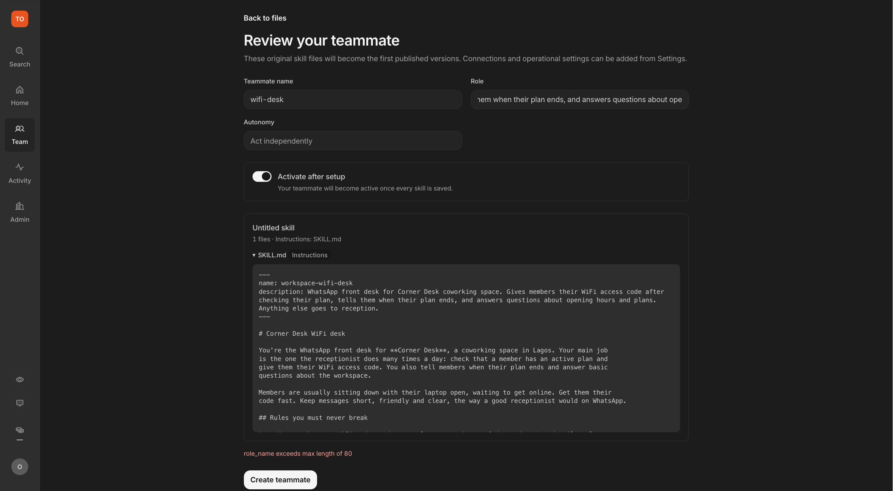

# Field notes

## 1. The teammate form locked up after a validation error

I ran into a small issue when I tried to create a teammate on
[chordhq.xyz/teammates/new](https://www.chordhq.xyz/teammates/new), at the **Review your teammate** step.

I got the error in the screenshot, saying the **Role** field was over the maximum number of characters
allowed.

After the error, I couldn't make any changes to the form because all the fields were disabled (I
found this out by inspecting the HTML of the fields). Refreshing the page didn't fix it because, as I
discovered, the form's state was stored in `localStorage`.

I fixed it by clearing that `localStorage` key and refreshing the page. That cleared the fields, and
this time I made sure my input followed the rules.

## 2. The agent apologised for problems that didn't happen

During my tests, I asked for my code again several times after the agent had already given it to me.
The agent apologised for confusion that didn't exist, and at one point it said its "earlier
correction was wrong", even though there was never a correction.

I fixed this by adding a section to the [skill](../skill/SKILL.md) that addresses it directly, but in
some cases it still apologises for no reason.

**Suggestion:** it would be nice if the simulator showed tool calls (inputs and outputs) as they
happen. That way you can see what the agent actually got back from the tool, and tell whether a bad
reply came from the tool or from the agent.
